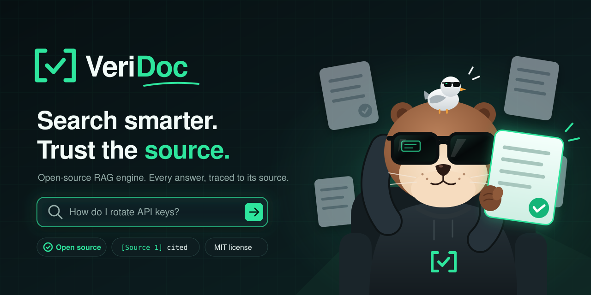
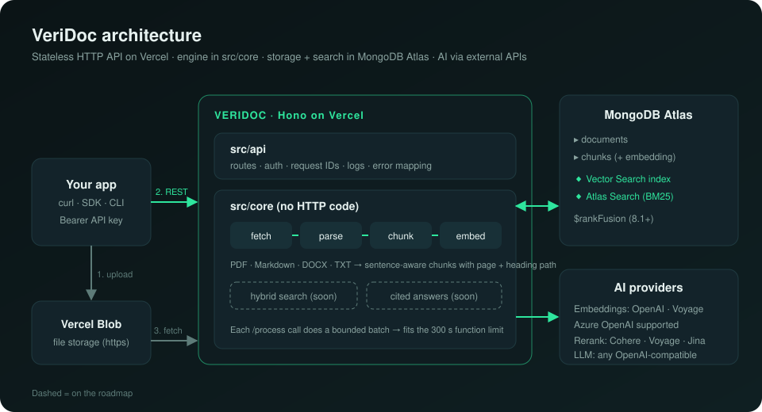
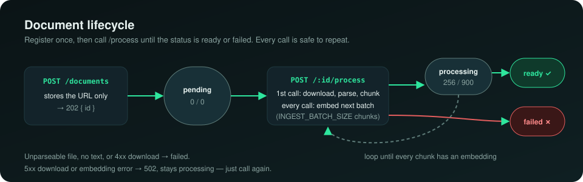
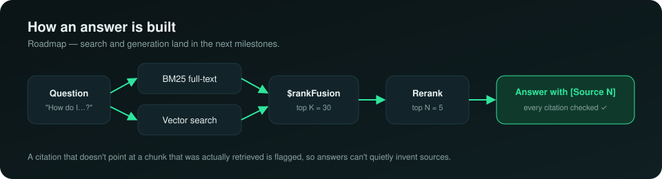

<div align="center">



An open-source RAG engine backend. Drop in your PDFs, Markdown, Word and text files. Ask questions. Get answers where every claim points back to the exact chunk it came from.

[](LICENSE)
[](https://nodejs.org)
[](https://hono.dev)
[](https://www.mongodb.com/atlas)
[](https://vercel.com)
[](#contributing)

[Quick start](#-quick-start) · [API docs](docs/API.md) · [Testing guide](docs/TESTING.md) · [Deploy](#-deploy-to-vercel) · [Roadmap](#-roadmap)

</div>

---

## ✨ Why VeriDoc?

Most RAG demos give you an answer and a vague "sources" list. VeriDoc is built around one rule: **if the model can't point to a retrieved chunk, it doesn't get to say it.**

- 🔎 **Hybrid retrieval** — BM25 full-text *and* vector search, fused with MongoDB's `$rankFusion`, then reranked.
- 🧾 **Verifiable citations** — the LLM must cite every claim as `[Source N]`, and each citation is checked against the chunks that were actually retrieved.
- 📄 **Real document structure** — chunks keep their page number (PDF) and heading path (`Guide > Install > Linux`) for Markdown and DOCX.
- ☁️ **Serverless-native** — stateless Hono API on Vercel. Long jobs are split into small, repeatable batches that fit inside the function time limit.
- 🔌 **Bring your own providers** — OpenAI, Azure OpenAI or Voyage for embeddings; Cohere, Voyage or Jina for reranking; any OpenAI-compatible LLM.
- 🧱 **Clean core** — the engine in `src/core` has no HTTP code, so you can use it from the API, a CLI or your own app.

> **Status:** 🚧 Early but working. Ingestion (upload → parse → chunk → embed) is done and tested. Hybrid search and cited answers are next. See the [roadmap](#-roadmap).

## 🏗️ How it works

<p align="center">
  
</p>

### Ingestion

Files are uploaded to storage first (Vercel Blob or any allowed https host), and VeriDoc gets the URL. Processing happens in small steps, so it never hits the serverless timeout:

<p align="center">
  
</p>

### Answering (coming next)

<p align="center">
  
</p>

## 🚀 Quick start

**You need:** Node.js 20.10+, [pnpm](https://pnpm.io), and a MongoDB Atlas cluster (8.1+, the free M0 tier works). For embeddings you also need an OpenAI, Azure OpenAI or Voyage key.

```bash
git clone https://github.com/dev-frog/VeriDoc.git
cd VeriDoc
pnpm install

cp .env.example .env     # set MONGODB_URI, OPENAI_API_KEY and VERIDOC_API_KEY
pnpm check               # checks config + every external service
pnpm db:setup            # creates collections and search indexes
pnpm dev                 # http://localhost:3000
```

Check that it's alive:

```bash
curl http://localhost:3000/health
# {"status":"ok","version":"0.1.0","db":"ok"}
```

Ingest your first document:

```bash
export KEY=<your VERIDOC_API_KEY>

# 1. Register a file by URL (set SOURCE_URL_HOSTS=* in .env to allow any https host locally)
curl -s -X POST localhost:3000/documents \
  -H "Authorization: Bearer $KEY" -H "Content-Type: application/json" \
  -d '{"url":"https://raw.githubusercontent.com/honojs/hono/main/README.md","fileName":"hono-readme.md"}'
# {"id":"6750c3…","status":"pending"}

# 2. Process it until it's ready
ID=<id from step 1>
until curl -s -X POST localhost:3000/documents/$ID/process -H "Authorization: Bearer $KEY" \
  | tee /dev/stderr | grep -qE '"status":"(ready|failed)"'; do sleep 1; done
```

Or ingest a whole local folder with no API calls at all:

```bash
pnpm ingest ./my-docs
```

👉 Full endpoint reference: **[docs/API.md](docs/API.md)** · How to test everything: **[docs/TESTING.md](docs/TESTING.md)**

## 📡 API at a glance

| Method | Path | What it does |
|---|---|---|
| `GET` | `/health` | Liveness + database check. No auth |
| `POST` | `/documents` | Register a file by URL → `202 { id, status: "pending" }` |
| `POST` | `/documents/:id/process` | Do the next batch of work → `{ status, processed, total }` |
| `GET` | `/documents` | List documents (newest first, cursor pagination, status filter) |
| `GET` | `/documents/:id` | Get one document |
| `DELETE` | `/documents/:id` | Delete a document and all its chunks |

All `/documents` routes need `Authorization: Bearer $VERIDOC_API_KEY`. Errors always look like `{ "error": { "code", "message" } }`. Details, examples and every error code are in **[docs/API.md](docs/API.md)**.

## 🧰 Scripts

| Command | What it does |
|---|---|
| `pnpm dev` | Dev server with auto-restart. Loads `.env` |
| `pnpm start` | Starts the server once. Does **not** load `.env` — variables must already be in the environment |
| `pnpm test` | Runs the unit + API test suite (no database or API keys needed) |
| `pnpm test:watch` | Tests in watch mode |
| `pnpm check` | Checks config and makes one tiny call to MongoDB, embeddings, reranker and LLM. `--offline` checks config only |
| `pnpm db:setup` | Creates collections and indexes, then waits for the search indexes. `--update` replaces existing search index definitions |
| `pnpm ingest <folder>` | Ingests every `.pdf`, `.md`, `.txt`, `.docx` in a folder (recursively). `--force` re-ingests files already done |

## ⚙️ Configuration

Only `MONGODB_URI` is required to boot. Each provider checks for its own key the first time it's used, so `/health` works before you add any AI keys. Empty values (`OPENAI_API_KEY=`) count as not set.

<details>
<summary><b>All environment variables</b></summary>

| Variable | Default | Notes |
|---|---|---|
| `MONGODB_URI` | (required) | `mongodb://` or `mongodb+srv://` |
| `MONGODB_DB` | `veridoc` | |
| `EMBED_PROVIDER` | `openai` | `openai` or `voyage` |
| `EMBED_MODEL` | `text-embedding-3-small` | Deployment name on Azure |
| `EMBED_DIMENSIONS` | `1536` | Must match the vector index — rerun `pnpm db:setup --update` if you change it |
| `OPENAI_BASE_URL` | `https://api.openai.com/v1` | Can point at Azure OpenAI |
| `OPENAI_API_KEY` | | |
| `VOYAGE_API_KEY` | | |
| `RERANK_PROVIDER` | `cohere` | `cohere`, `voyage`, `jina` or `none` |
| `COHERE_API_KEY` | | |
| `JINA_API_KEY` | | |
| `LLM_BASE_URL` | `https://api.openai.com/v1` | Any OpenAI-compatible API |
| `LLM_API_KEY` | | |
| `LLM_MODEL` | `gpt-4o-mini` | |
| `VERIDOC_API_KEY` | | Protects VeriDoc's own endpoints. Required in production |
| `BLOB_READ_WRITE_TOKEN` | | Vercel Blob (added for you when you connect a Blob store) |
| `CHUNK_TOKENS` | `600` | Target chunk size in tokens. Minimum 50 |
| `CHUNK_OVERLAP` | `0.12` | Fraction from 0 to 0.5 |
| `TOP_K` | `30` | Candidates retrieved before reranking |
| `TOP_N` | `5` | Chunks kept after reranking. Must be ≤ `TOP_K` |
| `SOURCE_URL_HOSTS` | `*.public.blob.vercel-storage.com` | Hosts `POST /documents` may download from: `*`, `*.example.com` or exact hosts. https only |
| `MAX_FILE_MB` | `50` | Largest file that will be downloaded |
| `INGEST_BATCH_SIZE` | `256` | Chunks embedded per `/process` call |
| `EMBED_BATCH_SIZE` | `64` | Texts per embedding API request |
| `LOG_FORMAT` | `pretty` locally, `json` in production | `pretty`, `json` or `off` |
| `PORT` | `3000` | Local dev only |

If the config is invalid, the server refuses to start and lists every problem:

```
Invalid environment configuration:
  - MONGODB_URI: is required
```

</details>

<details>
<summary><b>Using Azure OpenAI</b></summary>

Azure OpenAI has an OpenAI-compatible v1 API at `https://<resource>.openai.azure.com/openai/v1` (no `api-version` needed). Point both embeddings and the LLM at it, and use your **deployment names** as model names:

```bash
EMBED_PROVIDER=openai
OPENAI_BASE_URL=https://<resource>.openai.azure.com/openai/v1
OPENAI_API_KEY=<azure key>
EMBED_MODEL=text-embedding-3-small     # embedding deployment name
EMBED_DIMENSIONS=1536

LLM_BASE_URL=https://<resource>.openai.azure.com/openai/v1
LLM_API_KEY=<azure key>
LLM_MODEL=gpt-5-chat                   # chat deployment name
```

For `*.openai.azure.com` hosts, VeriDoc sends the key in the `api-key` header instead of `Authorization: Bearer`. Run `pnpm check` to confirm both deployments answer.

Docs: https://learn.microsoft.com/azure/ai-foundry/openai/api-version-lifecycle

</details>

## ▲ Deploy to Vercel

<details>
<summary><b>Step-by-step</b></summary>

**1. Prepare MongoDB Atlas**

- Under **Network Access**, allow `0.0.0.0/0` (Vercel functions don't have fixed IPs unless you buy the static IP add-on).
- Create a database user with a strong password.
- Copy the `mongodb+srv://…` connection string from **Connect → Drivers**.

**2. Link the project**

```bash
pnpm add -g vercel
vercel login
vercel link          # framework preset "Other", no build command
```

**3. Set environment variables** (each command prompts for the value)

```bash
vercel env add MONGODB_URI production
vercel env add MONGODB_DB production
vercel env add VERIDOC_API_KEY production
vercel env add OPENAI_API_KEY production
vercel env add COHERE_API_KEY production
vercel env add LLM_API_KEY production
```

Repeat with `preview` (and `development` if you use `vercel dev`), or use **Project → Settings → Environment Variables**. For `BLOB_READ_WRITE_TOKEN`, create a Blob store under **Storage → Create → Blob** and connect it to the project.

**4. Deploy and verify**

```bash
vercel --prod
curl -i https://<your-project>.vercel.app/health
```

- `/health` returns 200 with `"db":"ok"`.
- `/anything` returns a JSON `not_found` error. A non-JSON 404 means the rewrite to `/api` isn't working.
- **Settings → Functions**: Fluid compute is on. Without it, Hobby functions may be capped at 60 s instead of the 300 s in `vercel.json`.

Env vars only apply to deployments made after you set them — redeploy after changing one.

</details>

**Serverless limits VeriDoc is designed around:** ~300 s per function call (so work is batched), 4.5 MB request bodies (so files go to Blob first and the API gets a URL), no local ML models, and no in-memory state between requests.

## 🗂️ Project layout

```
veridoc/
├── src/
│   ├── core/          # the engine: ingest (fetch, parsers, chunker), embed providers, errors
│   ├── api/           # Hono app, routes, auth, request logger
│   ├── db/            # MongoClient, collections, indexes, ingest repository
│   ├── config.js      # env validation with zod
│   └── server.js      # local dev entry
├── api/index.js       # Vercel entry
├── scripts/           # check, setup-indexes, ingest-cli, smoke-test.sh
├── tests/             # vitest suites (in-memory repo, no network)
└── docs/              # API reference, testing guide, diagrams
```

<details>
<summary><b>Data model & indexes</b></summary>

Typedefs live in `src/core/types.js`.

**`documents`** — `{ _id, fileName, mimeType, sourceUrl, pageCount, status, error, chunkCount, processedCount, parsedAt, createdAt, updatedAt }`, where `status` is `pending`, `processing`, `ready` or `failed`.

**`chunks`** — `{ _id, docId, chunkIndex, text, embedding, page, heading, tokenCount, createdAt }`. `embedding` is missing until the chunk has been embedded.

| Collection | Index | Type |
|---|---|---|
| `chunks` | `docId_chunkIndex` (`{ docId: 1, chunkIndex: 1 }`, unique) | Regular |
| `chunks` | `chunks_vector` — `embedding` (cosine, `EMBED_DIMENSIONS`), filter on `docId` | Atlas Vector Search |
| `chunks` | `chunks_text` — `text`, `heading` (lucene.standard), plus `docId` | Atlas Search (BM25) |
| `documents` | `createdAt_desc` | Regular |

The free M0 tier allows up to 3 search indexes. If you change `EMBED_DIMENSIONS`, run `pnpm db:setup --update` and re-embed every document.

</details>

<details>
<summary><b>How chunking works</b></summary>

- **Size:** about `CHUNK_TOKENS` tokens, counted with js-tiktoken `cl100k_base`.
- **Boundaries:** whole sentences. A sentence is only split if it alone is longer than `CHUNK_TOKENS`.
- **Overlap:** each chunk repeats whole trailing sentences from the previous one, up to `CHUNK_OVERLAP`.
- **Sections:** a chunk never spans two sections, so it has exactly one page and one heading path.
- **Embedding input:** the heading path is prepended to the embedded text; the stored text stays unchanged.

| Format | `page` | `heading` |
|---|---|---|
| PDF | Page number | null |
| Markdown | null | Path from `#` headings |
| DOCX | null | Path from Word's built-in **Heading 1–6** styles (bold text styled to look like a heading isn't detected) |
| TXT | null | null |

Scanned PDFs without a text layer need OCR, which isn't supported yet.

</details>

## 🗺️ Roadmap

- [x] Project setup, config validation, `/health`
- [x] Data model, Atlas Vector + Search indexes
- [x] Ingestion: PDF / Markdown / DOCX / TXT parsers, sentence-aware chunker, batched embedding
- [x] Document API, request IDs, structured logs, `pnpm check` diagnostics
- [ ] Hybrid search endpoint (`$rankFusion` + rerank)
- [ ] Answer endpoint with `[Source N]` citations and citation verification
- [ ] Evaluation scripts
- [ ] Upload helper for Vercel Blob
- [ ] OCR for scanned PDFs

## 🤝 Contributing

Issues and PRs are welcome! To get going:

1. Fork the repo and create a branch: `git checkout -b feat/my-change`
2. `pnpm install && pnpm test` — the suite runs fully offline
3. Keep HTTP code in `src/api` and engine code in `src/core`
4. Add tests for new behaviour, then open a PR describing what and why

Found a security issue? Please open a private advisory on GitHub rather than a public issue.

## 📄 License

[MIT](LICENSE) © 2026 frog
